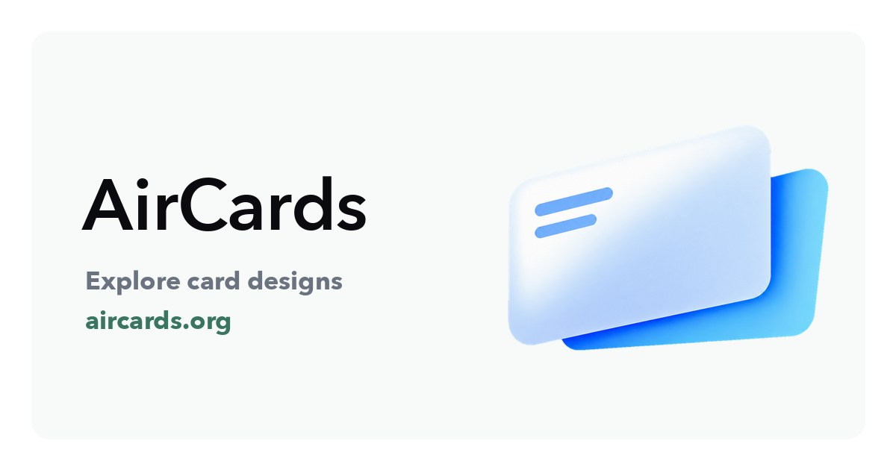

# AirCards

**Discover, create, and share card artwork.**

[Visit AirCards](https://aircards.org/en/) · [Getting started](https://aircards.org/en/guide/) · [FAQ](https://aircards.org/en/faq/) · [简体中文](README.zh-CN.md)

AirCards brings together curated card artwork and creator submissions to help you find a design for your own Apple Wallet cards.

## Explore, create, share

- **Explore the gallery** — browse card designs and download artwork you like.
- **Create your own** — use the online studio to compose a card design and export an image.
- **Share with the community** — submit your work for review and discover other creators' designs.
- **Browse in your language** — English, Simplified Chinese, Traditional Chinese, Japanese, and Korean.

## Get started

1. Visit [aircards.org](https://aircards.org/en/).
2. Browse the gallery or open the [card artwork studio](https://aircards.org/en/upload/).
3. Download an image and follow the [usage guide](https://aircards.org/en/guide/) for the next steps.

AirCards is an artwork website. **AirCard** is a separate project used to change how cards appear in Wallet on supported devices. Refer to the guide and AirCard's own documentation for compatibility and usage.

## Feedback

Found a website problem or have an idea? [Open an issue](https://github.com/aircards-org/aircards/issues/new/choose) in English or Chinese.

For account questions, security concerns, or artwork correction/removal requests, contact **contact@aircards.org**. Please do not include card numbers, account credentials, or other private information in public issues.

## About this repository

This is the official **product overview and feedback repository** for AirCards. It contains public documentation and presentation assets only. **The AirCards application is not open source; its source code is not included here.**

AirCards is not affiliated with Apple, banks, or the AirCard project. Artwork and trademarks may be subject to third-party rights; public availability does not grant permission to reuse them. Contact us for artwork corrections or removal requests.
